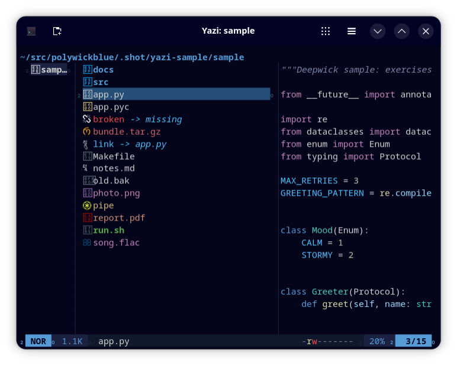

# Deepwick for Yazi

Deepwick colors for [Yazi](https://yazi-rs.github.io), as a flavor.

> Deepwick is an unofficial theme derived from
> [Polywick Blue](https://vscode.polywickstudio.net) by Polywick Studio (MIT).
> Not affiliated with Polywick Studio.



## Install

This repository is a Yazi flavor. Clone it into your flavors directory:

```sh
git clone https://github.com/deepwick/yazi.git \
  "${XDG_CONFIG_HOME:-$HOME/.config}/yazi/flavors/deepwick.yazi"
```

(or copy `flavor.toml` and `tmtheme.xml` into that directory).

## Activate

In `${XDG_CONFIG_HOME:-$HOME/.config}/yazi/theme.toml`:

```toml
[flavor]
dark = "deepwick"
```

## Notes

- Code previews use the same tmTheme as
  [Deepwick for bat](https://github.com/deepwick/bat).
- File icons keep Yazi's built-in icon colors.
- A style you set in `theme.toml` replaces the flavor's style for that key
  entirely (it does not merge).
- File names: directories Blue bold, executables Green bold, symlinks Cyan,
  broken links Red, FIFOs/sockets/devices Gold, archives Rose, media Magenta,
  documents Orange.

Tested with Yazi 26.5.6.

## License

MIT. See [LICENSE](LICENSE).
